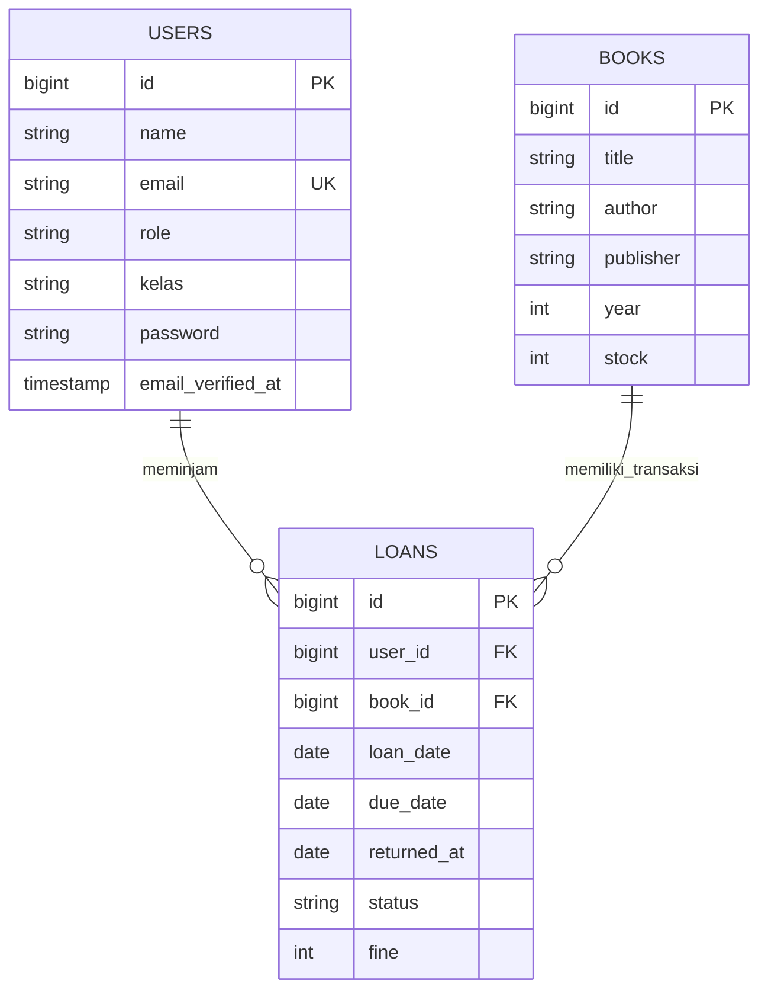

📚 Sistem Informasi Peminjaman Buku Perpustakaan

Aplikasi berbasis web menggunakan Laravel yang dibuat untuk membantu proses pendataan buku serta pengelolaan transaksi peminjaman dan pengembalian buku pada perpustakaan sekolah.

---

Deskripsi Aplikasi

Sistem ini memiliki tiga tabel utama yang digunakan untuk menyimpan informasi, yaitu `books`, `users`, dan `loans`.

Pada tabel `users`, terdapat atribut `role` untuk membedakan jenis akun yang menggunakan aplikasi.

| Role | Fungsi |
|---|---|
| `admin` | Bertanggung jawab atas pengelolaan koleksi buku dan pemantauan transaksi peminjaman. |
| `siswa` | Pengguna yang dapat melakukan peminjaman buku. Informasi kelas disimpan melalui kolom `kelas`. |

Proses Peminjaman dan Pengembalian

1. Siswa memilih buku yang tersedia untuk dipinjam.
2. Sistem menyimpan transaksi ke tabel `loans` dengan informasi tanggal peminjaman (`loan_date`), tanggal jatuh tempo (`due_date`), dan status `dipinjam`.
3. Ketika buku dikembalikan, sistem menyimpan tanggal pengembalian pada kolom `returned_at`.
4. Status transaksi diperbarui sesuai kondisi pengembalian buku.
5. Apabila pengembalian melewati batas waktu, jumlah denda dicatat pada kolom `fine`.

---

Fitur dan Pengelolaan Data

- Books: Menyimpan informasi buku yang meliputi judul, penulis, penerbit, tahun terbit, dan jumlah persediaan.
- Users: Mengelola informasi akun pengguna, termasuk nama, email, password, role, dan kelas.
- Loans: Menyimpan catatan peminjaman, tanggal pengembalian, status transaksi, serta denda keterlambatan.

Teknologi Pengembangan

- PHP
- Laravel
- MySQL
- XAMPP
- Composer

---

ERD (Entity Relationship Diagram)

Berikut merupakan rancangan hubungan tabel yang digunakan dalam aplikasi perpustakaan.



Keterangan Relasi

- Satu pengguna dapat melakukan lebih dari satu transaksi peminjaman.
- Satu buku dapat tercatat dalam beberapa transaksi peminjaman.
- Setiap transaksi memiliki hubungan dengan satu pengguna dan satu buku.

Hubungan tersebut menggunakan konsep *One-to-Many* antara tabel `users` dengan `loans`, serta `books` dengan `loans`.

---

Dokumentasi Model dan Fungsi

1. Model Book

File: `app/Models/Book.php`

| Bagian | Jenis | Penjelasan |
|---|---|---|
| `$fillable` | Properti | Menentukan kolom buku yang dapat diisi melalui mass assignment, yaitu `title`, `author`, `publisher`, `year`, dan `stock`. |

Relasi yang digunakan untuk mengakses transaksi berdasarkan buku:

```php
use Illuminate\Database\Eloquent\Relations\HasMany;

public function loans(): HasMany
{
    return $this->hasMany(Loan::class);
}
```

2. Model Loan

File: `app/Models/Loan.php`

| Bagian | Jenis | Parameter | Return | Penjelasan |
|---|---|---|---|---|
| `$fillable` | Properti | - | - | Mengatur atribut transaksi yang boleh diisi. |
| `$casts` | Properti | - | - | Mengatur konversi kolom tanggal menjadi objek tanggal. |
| `user()` | Relasi | - | `BelongsTo` | Mengambil informasi pengguna berdasarkan `user_id`. |
| `book()` | Relasi | - | `BelongsTo` | Mengambil informasi buku melalui `book_id`. |

Contoh pemanggilan relasi:

```php
$loan->user->name;
$loan->book->title;
```

3. Model User

File: `app/Models/User.php`

| Bagian | Jenis | Parameter | Return | Penjelasan |
|---|---|---|---|---|
| `$fillable` | Properti | - | - | Mengatur kolom `name`, `email`, `password`, `role`, dan `kelas`. |
| `$hidden` | Properti | - | - | Menyembunyikan password dan remember token. |
| `casts()` | Fungsi | - | `array` | Mengatur tipe data tanggal verifikasi email dan proses hashing password. |
| `isAdmin()` | Fungsi | - | `bool` | Mengecek apakah pengguna mempunyai role admin. |

Contoh fungsi pengecekan admin:

```php
public function isAdmin(): bool
{
    return $this->role === 'admin';
}
```

Relasi untuk mengambil daftar transaksi milik pengguna:

```php
use Illuminate\Database\Eloquent\Relations\HasMany;

public function loans(): HasMany
{
    return $this->hasMany(Loan::class);
}
```

---

Konfigurasi Route

File: `routes/web.php`

Untuk saat ini, route yang tersedia masih digunakan untuk menampilkan halaman awal aplikasi.

| Method | URL | Fungsi | Hasil |
|---|---|---|---|
| GET | `/` | Menjalankan route utama melalui closure. | Memuat halaman `welcome`. |

Contoh implementasi:

```php
Route::get('/', function () {
    return view('welcome');
});
```

---

Analisis dan Perbaikan Sistem

Berdasarkan struktur kode yang tersedia, terdapat beberapa bagian yang masih perlu diperhatikan dalam proses pengembangan.

| No. | Permasalahan | Akibat | Solusi yang Diperlukan |
|---|---|---|---|
| 1 | Model Book belum mempunyai relasi ke Loan. | Data transaksi berdasarkan buku tidak bisa dipanggil menggunakan `$book->loans`. | Membuat relasi `hasMany`. |
| 2 | Model User belum mempunyai relasi ke Loan. | Riwayat peminjaman pengguna tidak dapat diakses melalui `$user->loans`. | Menambahkan relasi `hasMany`. |
| 3 | Controller untuk buku dan peminjaman belum tersedia. | Proses pengelolaan data belum dapat dijalankan melalui halaman web. | Membuat BookController dan LoanController. |
| 4 | Status transaksi masih menggunakan string biasa. | Berpotensi terjadi perbedaan penulisan status. | Menggunakan konstanta atau enum PHP. |
| 5 | Pengaturan stok belum terhubung dengan transaksi. | Jumlah buku dapat menjadi tidak sesuai dengan persediaan sebenarnya. | Menggunakan `DB::transaction()` untuk mengatur perubahan stok. |

Contoh Penambahan Relasi

Pada model Book:

```php
use Illuminate\Database\Eloquent\Relations\HasMany;

public function loans(): HasMany
{
    return $this->hasMany(Loan::class);
}
```

Pada model User:

```php
use Illuminate\Database\Eloquent\Relations\HasMany;

public function loans(): HasMany
{
    return $this->hasMany(Loan::class);
}
```

---

Permasalahan yang Berpotensi Terjadi

Berikut beberapa error Laravel yang perlu diketahui ketika menjalankan atau mengembangkan aplikasi.

| Error | Penyebab | Penyelesaian |
|---|---|---|
| `SQLSTATE[42S02]: Base table or view not found` | Tabel yang dibutuhkan belum terbentuk atau urutan migration tidak tepat. | Periksa timestamp migration dan jalankan migration kembali. |
| `SQLSTATE[23000]: Integrity constraint violation` | Nilai foreign key tidak ditemukan pada tabel induk. | Pastikan ID pengguna dan buku sudah tersedia. |
| `MassAssignmentException` | Atribut belum diizinkan pada `$fillable`. | Tambahkan kolom yang diperlukan ke `$fillable`. |
| `RelationNotFoundException` | Relasi yang dipanggil belum tersedia pada model. | Periksa dan buat method relasi. |
| `Class "App\Models\Loan" not found` | Nama file, namespace, atau autoload tidak sesuai. | Periksa model dan jalankan `composer dump-autoload`. |
| `SQLSTATE[HY000] [1049] Unknown database` | Database belum dibuat atau konfigurasi nama database keliru. | Sesuaikan nama database pada `.env`. |
| `Carbon\Exceptions\InvalidFormatException` | Data tanggal tidak menggunakan format yang sesuai. | Validasi tanggal menggunakan format `Y-m-d`. |

Perintah untuk Membantu Debugging

Beberapa perintah yang dapat digunakan selama pengembangan:

```bash
# Menampilkan seluruh route
php artisan route:list

# Melihat status migration
php artisan migrate:status

# Memperbarui autoload
composer dump-autoload

# Menjalankan Tinker
php artisan tinker
```

Contoh pengecekan data transaksi:

```php
App\Models\Loan::with('user', 'book')->first();
```

Untuk melihat isi variabel saat terjadi kesalahan:

```php
dd($loan);
```

Untuk menyimpan informasi ke log:

```php
Log::info('Data peminjaman', $data);
```

File log Laravel berada di:

`storage/logs/laravel.log`

Selama pengembangan lokal, `APP_DEBUG=true` dapat digunakan untuk melihat informasi error secara lebih terperinci.

---

Panduan Instalasi dan Menjalankan Proyek

1. Download Repository

Clone proyek dari GitHub menggunakan perintah berikut:

```bash
git clone https://github.com/kalilasyifazzahra/peminjaman-buku.git
cd peminjaman-buku
```

2. Install Library

Jalankan Composer untuk memasang seluruh dependency Laravel.

```bash
composer install
```

3. Konfigurasi Environment

Salin file `.env.example` menjadi `.env`.

```bash
cp .env.example .env
php artisan key:generate
```

4. Membuat Database

Buka phpMyAdmin, kemudian buat database dengan nama:

`peminjaman_buku`

Atur koneksi database pada file `.env`:

```env
DB_CONNECTION=mysql
DB_HOST=127.0.0.1
DB_PORT=3306
DB_DATABASE=peminjaman_buku
DB_USERNAME=root
DB_PASSWORD=
```

5. Membuat Struktur Tabel

Setelah database terhubung, jalankan:

```bash
php artisan migrate
```

Perintah tersebut akan membuat tabel sesuai file migration yang tersedia.

6. Menjalankan Web

Gunakan perintah:

```bash
php artisan serve
```

Kemudian buka browser dan kunjungi:

`http://127.0.0.1:8000`

File Database

Apabila file `database/peminjaman_buku.sql` tersedia, database juga dapat dimasukkan melalui fitur Import pada phpMyAdmin. Alternatif lainnya adalah membentuk tabel menggunakan migration Laravel.

---

Laporan Hasil Pengembangan

Tujuan Pembuatan

Membuat aplikasi perpustakaan berbasis Laravel yang dapat digunakan sebagai sarana pengelolaan informasi buku dan pencatatan transaksi peminjaman oleh siswa.

Hasil yang Telah Dikerjakan

Beberapa bagian yang telah disiapkan dalam proyek ini meliputi:

- Perancangan database dengan tiga tabel utama, yaitu `users`, `books`, dan `loans`.
- Pembuatan ERD untuk menggambarkan hubungan antar tabel.
- Pembuatan migration sebagai struktur awal database.
- Penyusunan model Book, Loan, dan User.
- Pengaturan atribut model melalui `$fillable`, `$hidden`, dan `$casts`.
- Penggunaan foreign key untuk menghubungkan data pengguna, buku, dan transaksi.
- Penerapan pembagian jenis akun melalui kolom `role`.
- Penyusunan dokumentasi penggunaan dan penanganan error.

Kendala Selama Pengerjaan

Dalam proses pengembangan terdapat beberapa hal yang perlu diperhatikan:

1. Proses pengiriman proyek ke GitHub sempat mengalami masalah berupa `Repository not found` dan `rejected`.
2. Pengaturan remote repository perlu diperiksa kembali agar sesuai dengan alamat repository yang digunakan.
3. Urutan migration perlu disesuaikan karena tabel transaksi bergantung pada tabel pengguna dan buku.
4. Beberapa relasi model dan fitur transaksi masih membutuhkan pengembangan lebih lanjut.

Kekurangan Aplikasi Saat Ini

- Fitur CRUD buku belum tersedia.
- Pengelolaan transaksi belum dilengkapi controller.
- Halaman khusus admin dan siswa belum dikembangkan.
- Pengurangan dan penambahan stok belum diterapkan.
- Perhitungan denda belum terintegrasi.
- Pengujian aplikasi belum dilakukan secara menyeluruh.

Target Pengembangan

Untuk melanjutkan pengerjaan, berikut beberapa fitur yang akan dikembangkan:

1. Menyelesaikan relasi antara Book, User, dan Loan.
2. Mengembangkan controller untuk pengelolaan data buku.
3. Membuat proses peminjaman dan pengembalian.
4. Menambahkan perhitungan denda berdasarkan keterlambatan.
5. Mengatur persediaan buku secara otomatis.
6. Menambahkan autentikasi serta pembatasan akses berdasarkan role.
7. Melakukan pengujian untuk memastikan setiap fitur berjalan dengan baik.

---

Kesimpulan

Aplikasi Sistem Peminjaman Buku Perpustakaan telah memiliki rancangan dasar yang mencakup struktur database, model Laravel, serta relasi antar tabel.

Pembuatan fondasi tersebut menjadi langkah awal dalam membangun sistem pengelolaan perpustakaan sekolah. Selanjutnya, pengembangan akan diarahkan pada pembuatan controller, route, dan halaman aplikasi agar proses pengelolaan buku maupun transaksi peminjaman dapat dilakukan secara langsung melalui web.
